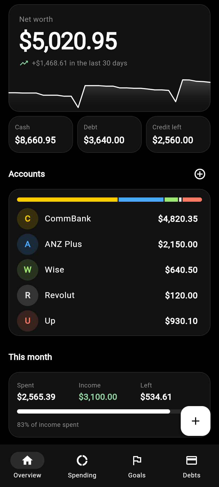
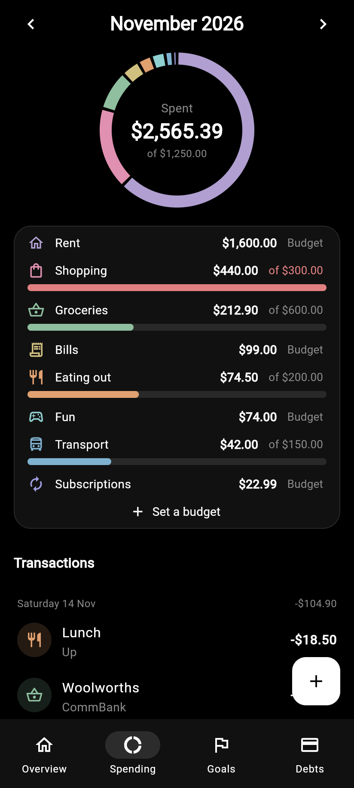
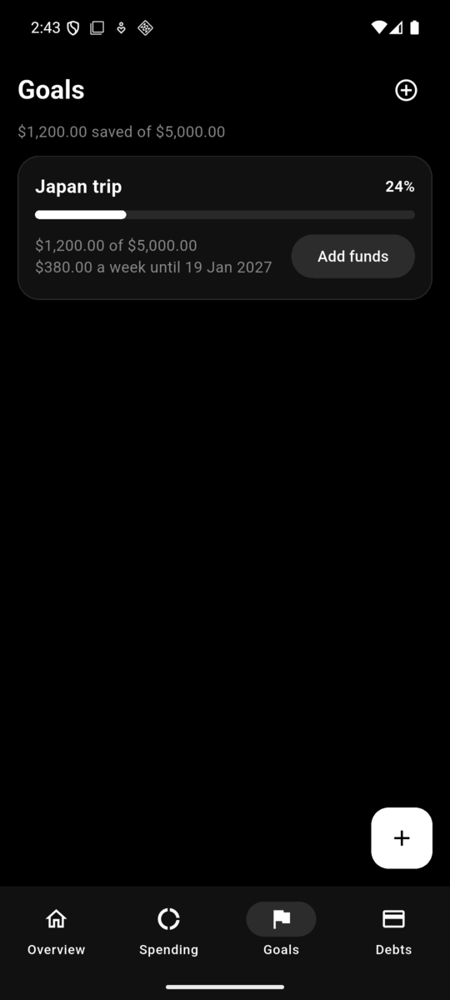
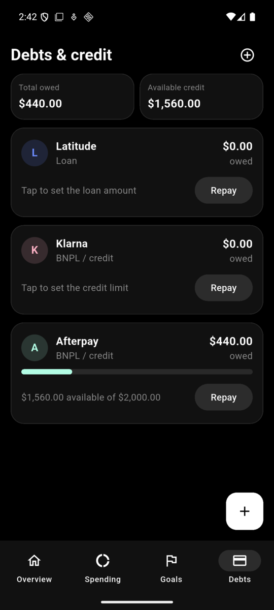
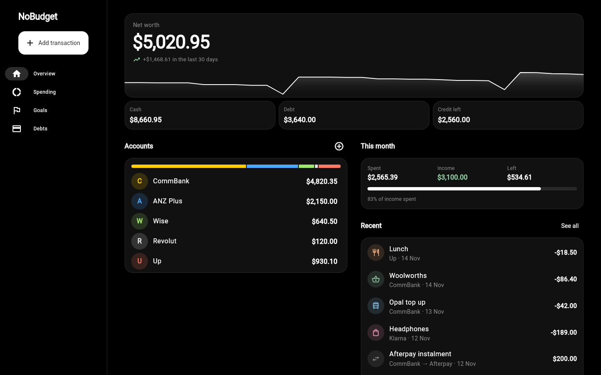
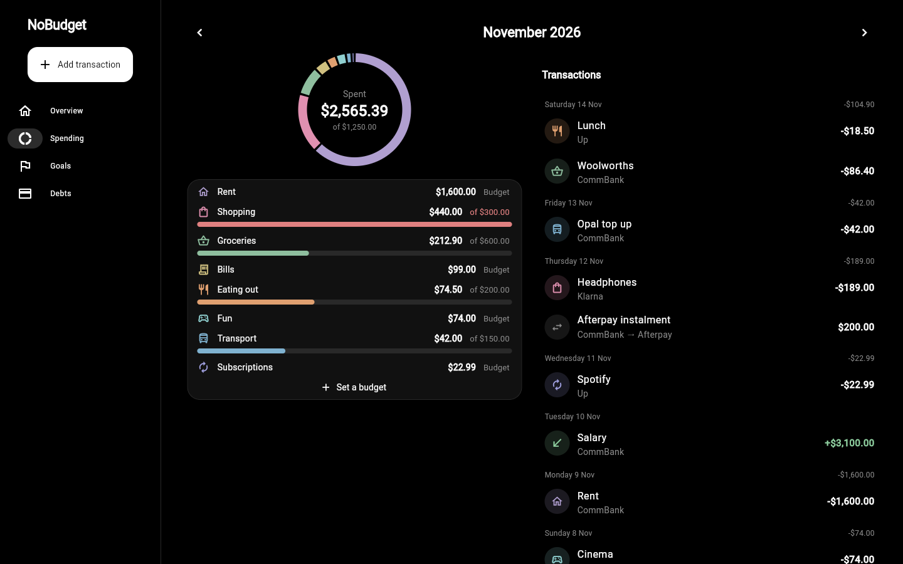

# NoBudget

A personal budgeting app for Android and the web, built with Flutter. Everything is entered by hand:
there are no bank connections. You sign in with Google or with an email and password, and your budget is kept in
your own private space in the cloud (Firebase), so it is backed up and the same on every device.

**Try it in a browser: <https://raigon-pawa.github.io/NoBudget/>**

<p>
  
  
  
  
</p>

On a wide screen the same app lays itself out in two columns with a side rail:

<p>
  
  
</p>

## Features

- **Overview**: net worth with a 30-day trend, cash, debt and credit left, and balances across your
  bank accounts.
- **Spending**: expenses by category for each month, optional monthly budgets per category, and
  the full transaction history. Tap a slice of the chart to filter, swipe a transaction to delete it.
- **Goals**: savings targets with an optional deadline and the weekly amount needed to hit it.
- **Debts**: buy-now-pay-later, credit and loan accounts with the amount owed, available credit
  and one-tap repayments.
- **Repeating transactions**: mark rent, pay or a subscription as weekly, fortnightly or monthly and
  it is added for you when it falls due.
- **Search**: find any transaction by note, category, account or amount.
- **Backup**: copy everything as text from the menu on the net worth card, and paste it back to
  restore, on the same device or another one.
- **Currencies**: each account has a country and currency (32 to pick from). Totals are shown in
  your home currency, and a transfer between two currencies records both what left and what
  arrived. Exchange rates start from built-in values and are corrected by hand; the app does not
  look them up.
- **Transactions update balances for you**: paying with a BNPL account raises what you owe, and a
  transfer into a debt account counts as a repayment.

The app starts with a set of Australian accounts (CommBank, ANZ Plus, Wise, Revolut, Up, Latitude,
Klarna, Afterpay) that you can rename or delete, with Australia as the home country. Both can be
changed: the home country is under "Currencies" in the menu on the net worth card.

NoBudget is not affiliated with any of the banks or lenders named above.

## Build

You need the [Flutter SDK](https://docs.flutter.dev/get-started/install), plus an Android device or
emulator for the app, or Chrome for the website.

You also need a Firebase project of your own (the free Spark plan is enough) with a Firestore
database created. Connect the code to it once:

```sh
firebase login
dart pub global activate flutterfire_cli
flutterfire configure --platforms=android,web          # writes lib/firebase_options.dart and android/app/google-services.json (not in this repo)
firebase deploy --only firestore:rules,auth --project <your-project-id>   # security rules, and switches on email sign-in
```

For "Continue with Google", also do this in the Firebase console, then run `flutterfire configure`
again so the Android config picks up the Google client:

- Authentication → Sign-in method: enable Google (it asks for a public support email).
- Authentication → Settings → Authorised domains: add the address your website is served from.
- Project settings → your Android app: add the SHA-1 of the key the app is signed with
  (`keytool -list -v -keystore ~/.android/debug.keystore -storepass android` for the debug key).

Then:

```sh
flutter pub get
flutter test

flutter run                      # Android: debug build on a connected device
flutter build apk --release      # build/app/outputs/flutter-apk/app-release.apk

flutter run -d chrome            # web: debug in Chrome
flutter build web --release --no-web-resources-cdn    # build/web, static files for any web host
```

The Android release build is signed with the debug key, so it is for sideloading only. The web
build is a folder of static files; to try it locally, run `python3 -m http.server` inside
`build/web`. If it will be served from a sub-path, add `--base-href /that-path/` to the build.

The live site is the `gh-pages` branch, served by GitHub Pages. It does not update by itself; to
publish the current code:

```sh
flutter build web --release --no-web-resources-cdn --base-href /NoBudget/ -o /tmp/nobudget-site
cd /tmp/nobudget-site && touch .nojekyll && git init -b gh-pages && git add -A && git commit -m "Website build"
git push -f https://github.com/raigon-pawa/NoBudget.git gh-pages
```

Each account's data is one Firestore document that only that account can read or write
([`firestore.rules`](firestore.rules)). The app keeps a copy on the device, so it opens and saves
offline and catches up when the connection returns. Anything entered on a device before sign-in
existed moves into the first account created there. One document holds about 5,000 transactions.

To try changes without touching real data, run the Firebase emulators and point the app at them:

```sh
firebase emulators:start --only auth,firestore --project demo-nobudget
flutter run -d chrome --dart-define=EMULATOR=true
```

## Code layout

| File | What it holds |
|---|---|
| `lib/models.dart` | Accounts, transactions, goals, currencies and the money maths |
| `lib/store.dart` | The in-memory state the UI listens to, saved as one JSON document in the user's Firestore document |
| `lib/login.dart` | Sign in with Google or an email, create an account, reset a password |
| `lib/main.dart` | Firebase start-up, the sign-in gate, theme and the shell: bottom bar on a phone, side rail on a wide screen |
| `lib/pages.dart` | The four tabs |
| `lib/sheets.dart` | Forms for transactions, accounts and goals |
| `lib/ui.dart` | Shared widgets, categories and formatting |

Money is stored as integer cents, in the currency of the account it belongs to.

## Licence

[MIT](LICENSE)
