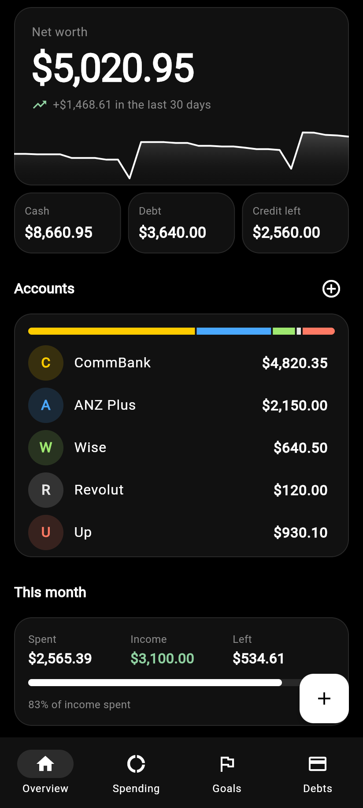
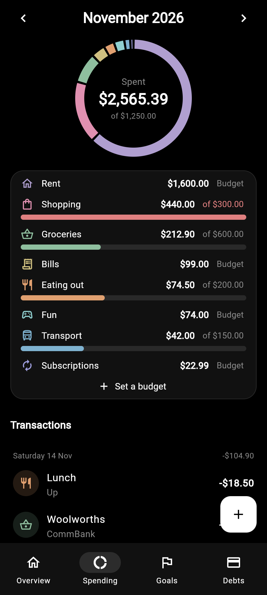
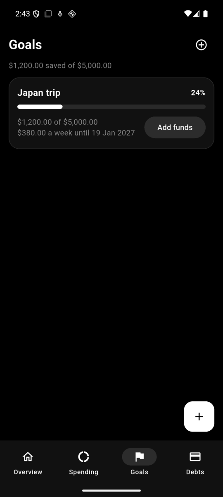
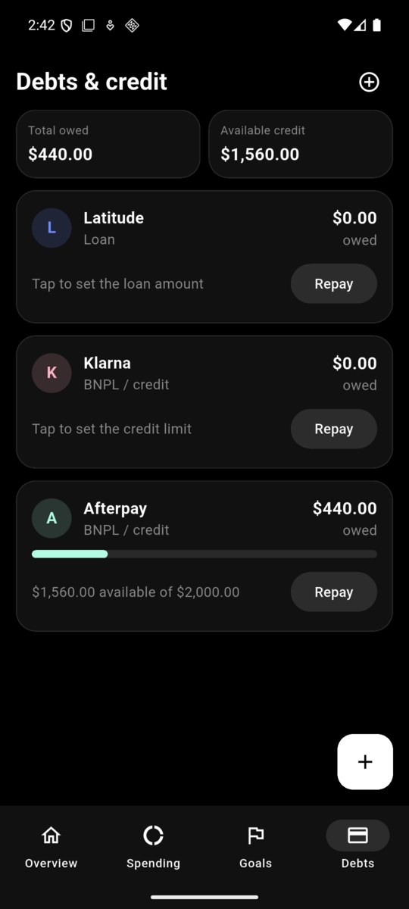
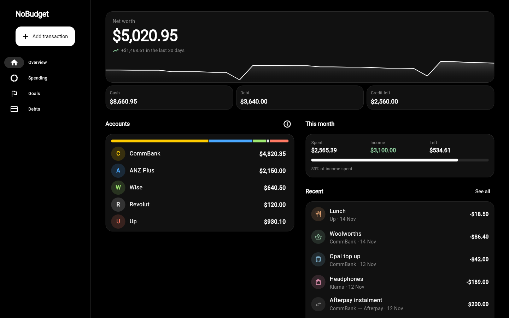
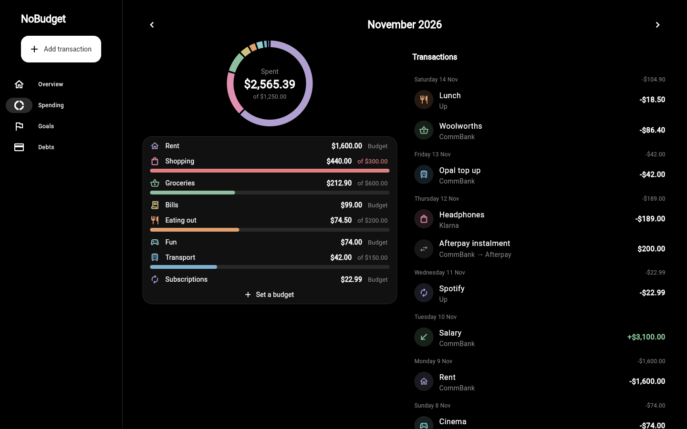

# NoBudget

A personal budgeting app for Android and the web, built with Flutter. Everything is entered by hand:
there are no bank connections. It needs no account: your budget is kept on your device and the app works
offline, the website too once it has been opened. To back it up and use it on several devices, sign in with
Google or an email and password from the menu, and a copy is kept in your own private space in the cloud (Firebase).

**Try it in a browser: <https://nobudget.raigonpawa.dev/>**

**Android:** download the APK from the [latest release](../../releases/latest).

<p>
  
  
  
  
</p>

On a wide screen the same app lays itself out in two columns with a side rail:

<p>
  
  
</p>

## Features

- **Overview**: net worth with a 30-day trend, cash, debt and credit left, and balances across your
  bank accounts.
- **Spending**: expenses by category for each month, optional monthly budgets per category, and
  the full transaction history. Tap a slice of the chart to filter, swipe a transaction to delete it.
  A bar chart shows the last six months, and how this month compares with the same days of last month.
- **Goals**: savings targets with an optional deadline and the weekly amount needed to hit it.
- **Debts**: buy-now-pay-later, credit and loan accounts with the amount owed, available credit
  and one-tap repayments.
- **Repeating transactions**: mark rent, pay or a subscription as weekly, fortnightly or monthly and
  it is added for you when it falls due. What is due in the next 30 days shows under "Coming up" on the
  Overview; tap one to change its amount, date or how often it repeats, or to stop it.
- **Search**: find any transaction by note, category, account or amount.
- **Sync**: sign in from the menu on the net worth card ("Sync across devices") to keep a copy in the
  cloud and the same budget on every device. Signing out keeps the data on the device unless you
  choose to remove it.
- **Backup**: copy everything as text from the menu on the net worth card, and paste it back to
  restore, on the same device or another one.
- **Currencies**: each account has a country and currency (32 to pick from), and adding an account
  suggests well-known banks, wallets and pay-later providers for the country you pick. Totals are shown in
  your home currency, and a transfer between two currencies records both what left and what
  arrived. Exchange rates update daily (built-in values until the first download), and you can
  set your own for any currency.
- **Transactions update balances for you**: paying with a BNPL account raises what you owe, and a
  transfer into a debt account counts as a repayment.

The app starts with a set of Australian accounts (CommBank, ANZ Plus, Wise, Revolut, Up, Latitude,
Klarna, Afterpay) that you can rename or delete, with Australia as the home country. Both can be
changed: the home country is under "Currencies" in the menu on the net worth card.

NoBudget is not affiliated with any of the banks or lenders named above or suggested in the app.

## Build

You need the [Flutter SDK](https://docs.flutter.dev/get-started/install), plus an Android device or
emulator for the app, or Chrome for the website.

Sync needs a Firebase project of your own (the free Spark plan is enough) with a Firestore
database created. Connect the code to it once (the app does not build without `lib/firebase_options.dart`):

```sh
firebase login
dart pub global activate flutterfire_cli
flutterfire configure --platforms=android,web          # writes lib/firebase_options.dart and android/app/google-services.json (not in this repo)
firebase deploy --only firestore:rules,auth --project <your-project-id>   # security rules, and switches on email sign-in
```

For "Continue with Google", also do this in the Firebase console, then run `flutterfire configure`
again so the Android config picks up the Google client:

- Authentication → Sign-in method: enable Google (it asks for a public support email).
- Authentication → Settings → Authorised domains: add the address your website is served from.
- Project settings → your Android app: add the SHA-1 of the key the app is signed with
  (`keytool -list -v -keystore ~/.android/debug.keystore -storepass android` for the debug key).

Then:

```sh
flutter pub get
flutter test

flutter run                      # Android: debug build on a connected device
flutter build apk --release      # build/app/outputs/flutter-apk/app-release.apk

flutter run -d chrome            # web: debug in Chrome
flutter build web --release --no-web-resources-cdn    # build/web, static files for any web host
```

The Android release build is signed with the debug key, so it is for sideloading only. The web
build is a folder of static files; to try it locally, run `python3 -m http.server` inside
`build/web`. If it will be served from a sub-path, add `--base-href /that-path/` to the build.

The live site is the `gh-pages` branch, served by GitHub Pages at nobudget.raigonpawa.dev (the
`CNAME` file names the domain). It does not update by itself; to
publish the current code:

```sh
flutter build web --release --no-web-resources-cdn -o /tmp/nobudget-site
cd /tmp/nobudget-site && touch .nojekyll && echo nobudget.raigonpawa.dev > CNAME && git init -b gh-pages && git add -A && git commit -m "Website build"
git push -f https://github.com/raigon-pawa/NoBudget.git gh-pages
```

The app keeps everything on the device (SharedPreferences, which is localStorage on the web), and
works the same signed in or not. Signed in, each account's data is also one Firestore document that
only that account can read or write ([`firestore.rules`](firestore.rules)). To stay well inside the
free limits, the app reads it when it opens or comes back to the front (at most once a minute), and
writes it once, 10 seconds after changes stop or when the app goes to the background; signed-out use
makes no requests at all. A new device takes the account's data; if both the device and the account
changed since they last synced, the app asks which one to keep. One document holds about 5,000
transactions. On the web, `web/sw.js` keeps a copy of the site so it opens offline.

To try changes without touching real data, run the Firebase emulators and point the app at them:

```sh
firebase emulators:start --only auth,firestore --project demo-nobudget
flutter run -d chrome --dart-define=EMULATOR=true
```

## Exchange rates

`tools/rates/update-rates.py` runs once a day on a machine at home: it fetches public-domain rates
([fawazahmed0/exchange-api](https://github.com/fawazahmed0/exchange-api), CC0), checks them and
pushes `rates.json` to the [nobudget-rates](https://github.com/raigon-pawa/nobudget-rates) repo.
The app downloads that file from GitHub at most twice a day and keeps it on the device, so the
machine only makes outbound connections and is never contacted by the app, and rates cost no
Firebase requests. A rate more than ten times off the built-in one is ignored.

To set it up on a Linux machine with systemd, python3 and git:

```sh
git clone https://github.com/raigon-pawa/NoBudget && NoBudget/tools/rates/install.sh
```

It makes an SSH key that only the rates repo accepts (add it there as a deploy key with write
access), and a daily systemd timer. Commits use a fixed name and UTC time, so they carry nothing
about the machine.

## Code layout

| File | What it holds |
|---|---|
| `lib/models.dart` | Accounts, transactions, goals, currencies and the money maths |
| `lib/store.dart` | The in-memory state the UI listens to, saved as one JSON document on the device and synced with the user's Firestore document |
| `lib/login.dart` | Firebase start-up, sign in with Google or an email, create an account, reset a password |
| `lib/main.dart` | Start-up, theme and the shell: bottom bar on a phone, side rail on a wide screen |
| `lib/pages.dart` | The four tabs |
| `lib/sheets.dart` | Forms for transactions, accounts and goals |
| `lib/ui.dart` | Shared widgets, categories and formatting |

Money is stored as integer cents, in the currency of the account it belongs to.

## Licence

[MIT](LICENSE)
